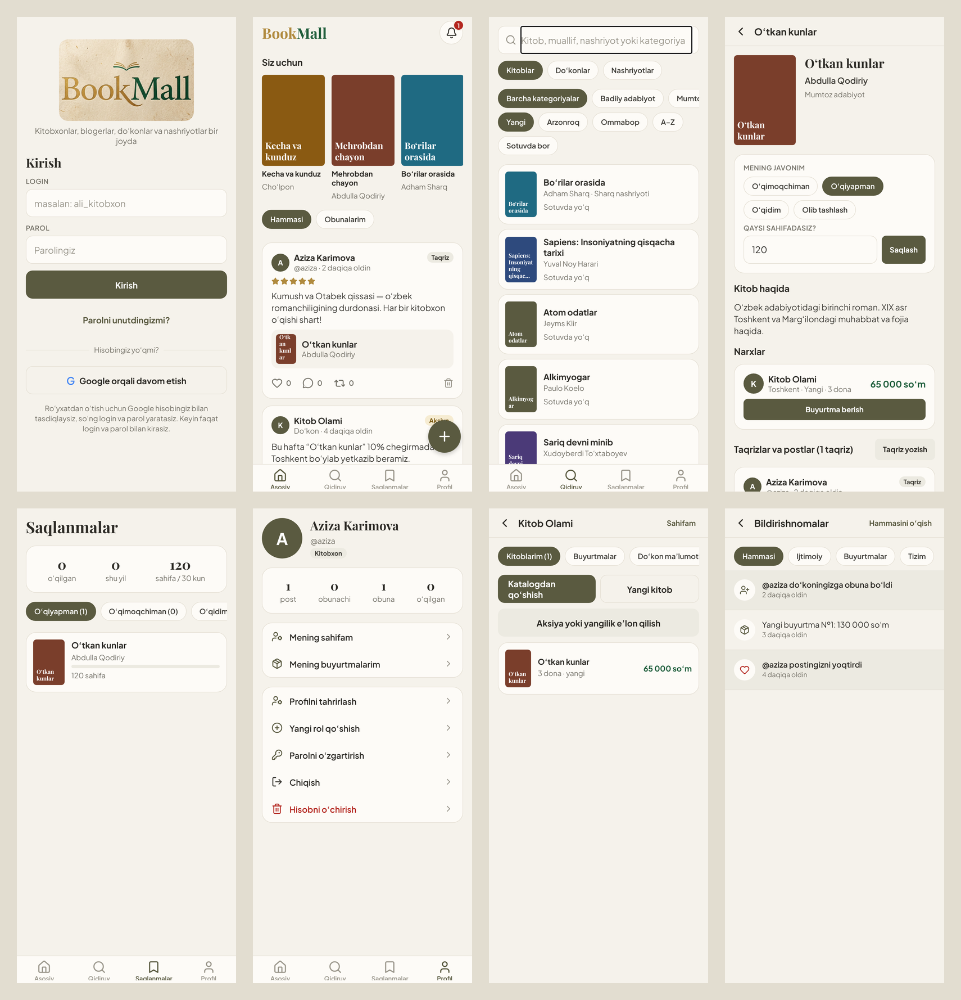

# BookMall — kitob ekotizimi (mobil ilova)

Kitobxonlar, kitob blogerlari, do‘konlar va nashriyotlarni bitta ilovada birlashtiruvchi platforma.
Kutubxona funksiyalari (ijara, a’zolik, kutubxona fondi) **yo‘q** — eski web loyihadagi bu qismlar olib tashlangan.

| Papka | Nima |
|---|---|
| `server/` | API server: Express + TypeScript, PostgreSQL (Drizzle ORM) |
| `mobile/` | Android va iOS ilova: Expo SDK 57, React Native, TypeScript, Expo Router |
| `docs/ekranlar.png` | Ilova ekranlari (sinov paytida olingan) |
| `bookmall---elektron-kutubxona (1).zip` | Eski web loyiha (faqat namuna sifatida) |

## Rollar

Bitta hisob — bir nechta rol (`user_roles`). Birinchi kirishda 4 tadan biri tanlanadi, keyin boshqalari qo‘shilishi mumkin:

| Rol | Imkoniyatlar |
|---|---|
| `READER` Kitobxon | qidiruv, narx solishtirish, buyurtma, javon, o‘qish statistikasi, post/taqriz, layk/izoh/repost, obuna |
| `BLOGGER` Bloger | + blog profili (sarlavha, muqova, sayt), matn/rasm/video postlar |
| `SELLER` Do‘kon | + do‘kon profili, katalogdan kitob tanlab narx/son bilan sotuvga qo‘yish, buyurtmalarni qabul qilish, do‘kon nomidan aksiya/yangi kelgan/e’lon |
| `PUBLISHER` Nashriyot | + nashriyot profili, o‘z kitoblarini katalogga qo‘shish, yangi nashr/yangiliklar |
| `ADMIN` | katalogga yuborilgan kitoblarni tasdiqlash/rad etish (`npm run make-admin -- <login>`) |

## Ma’lumotlar bazasi

```
users ─┬─< user_roles            (rollar)
       ├── blogger_profiles      (1:1)
       ├── stores ──< listings >── books ──> publishers
       ├── publishers                 │ └──> categories
       ├─< orders ──< order_items ────┘ (narx va nom o‘sha paytdagidek saqlanadi)
       ├─< posts ──< post_likes, comments;  posts.repost_of_id → posts
       ├─< follows (USER | STORE | PUBLISHER)
       ├─< user_books, reading_logs  (javon va o‘qish faolligi)
       ├─< notifications             (SOCIAL | ORDER | SYSTEM)
       └─< sessions, password_resets, media_files
```

- **Markaziy katalog** (`books`): kitob bir marta. ISBN (ISBN-13 ga keltiriladi) yoki nom+muallif “barmoq izi” (apostrof va harf farqisiz) bo‘yicha takror rad etiladi → `409 DUPLICATE_BOOK` va mavjud kitob qaytadi. Yangi kitob `PENDING`, admin tasdiqlagach `APPROVED`.
- **Takliflar** (`listings`): har do‘kon bir kitobni o‘z narxi (so‘m) va soni bilan; `GET /books/:id/offers` arzonidan saralangan.
- **Buyurtma**: bitta do‘kondan; zaxira tranzaksiyada qulflanib kamayadi, bekor qilinsa qaytadi.
- Kelajak uchun (BILLZ, ombor, ERP): `listings` alohida jadval, `orders` holatlari kengaytiriladi — hozir qilinmagan.

## API qisqacha

| Bo‘lim | Yo‘llar |
|---|---|
| Kirish | `/api/auth/*` — Google → login/parol, login, refresh, parolni tiklash, hisobni o‘chirish |
| Men | `GET /api/me`, `POST /api/me/roles`, `PUT /api/me/{store,publisher,blogger-profile}`, `PUT /api/profile/me` |
| Katalog | `GET /api/categories`, `GET /api/books?q=&author=&publisher=&category=&inStock=&sort=`, `GET /api/books/recommended`, `GET /api/books/:id`, `GET /api/books/:id/offers`, `POST/PUT /api/books` |
| Admin | `GET /api/admin/books?status=`, `POST /api/admin/books/:id/{approve,reject}` |
| Do‘kon/nashriyot | `GET /api/stores[/:slug]`, `GET /api/publishers[/:slug]`, `GET/POST/PUT/DELETE /api/listings` |
| Buyurtma | `POST /api/orders`, `GET /api/orders/{mine,store,:id}`, `POST /api/orders/:id/status` |
| Lenta | `GET /api/feed?scope=following|all`, `GET/POST/PUT/DELETE /api/posts`, `/like`, `/comments`, `/repost`, `POST/DELETE /api/follows`, `GET /api/users/:username[/followers|/following]` |
| Javon | `GET /api/me/books`, `PUT/DELETE /api/me/books/:id`, `POST /api/me/books/:id/progress`, `GET /api/me/reading-stats` |
| 🔔 | `GET /api/notifications?category=`, `GET /api/notifications/unread-count`, `POST /api/notifications/read` |
| Fayllar | `POST /api/uploads` (JPG/PNG/WEBP ≤10 MB, MP4/MOV ≤100 MB) → `/media/...` |

## Ishga tushirish

```bash
cd server
cp .env.example .env   # DATABASE_URL, JWT_SECRET, GOOGLE_CLIENT_IDS
npm install
npm run db:seed        # migratsiyalar + kategoriyalar + boshlang‘ich kitoblar
npm run dev
npm test               # 33 ta test (TEST_DATABASE_URL, standart: .../bookmall_test)
```

## Mobil ilova (`mobile/`)



| Bo‘lim | Ekranlar |
|---|---|
| Kirish | Login + parol, “Google orqali davom etish” → login/parol yaratish, “Parolni unutdingizmi?”, rol tanlash (4 rol) |
| Pastki menyu | **Asosiy** (tavsiyalar + lenta, 🔔), **Qidiruv** (kitob/do‘kon/nashriyot, kategoriya, saralash), **Saqlanmalar** (javon + statistika), **Profil** |
| Kitob | Ma’lumot, javon, o‘qilgan sahifa, baho, narxlar (arzonidan), buyurtma, taqrizlar |
| Ijtimoiy | Post yaratish (matn, rasm, video, kitob, baho; do‘kon/nashriyot nomidan), layk, izoh, repost, obuna, profil sahifalari |
| Do‘kon | Panel: katalogdan sotuvga qo‘yish, narx/son/holat/rasm, to‘xtatish, buyurtmalarni tasdiqlash/jo‘natish/bekor qilish, do‘kon profili |
| Nashriyot | Kitob qo‘shish/tahrirlash (holati bilan), yangiliklar, nashriyot profili |
| Admin | Katalog tekshiruvi: tasdiqlash / rad etish (sababi bilan) |
| Sozlamalar | Profil va rasm, blog profili, parolni o‘zgartirish, rol qo‘shish, chiqish, hisobni o‘chirish |

### Ishga tushirish

```bash
cd mobile
cp .env.example .env   # EXPO_PUBLIC_API_URL va Google Client ID'lar
npm install
npx expo start         # Google kirishsiz qismlar uchun
```

Google Sign-In “Expo Go” ichida ishlamaydi — buning uchun **development build** kerak:

```bash
npx eas build --profile development --platform android
```

### Do‘konlarga chiqarish

- Ilova identifikatori: `uz.bookmall.app` (Android va iOS)
- `eas.json` — `development`, `preview` (APK), `production` profillari
- `npx eas build --profile production --platform all`, so‘ng `npx eas submit`
- Kerak bo‘ladi: Expo hisobi, Google Play Console ($25), Apple Developer ($99/yil), Google Cloud OAuth Client ID’lar (Web, Android, iOS), maxfiylik siyosati sahifasi
